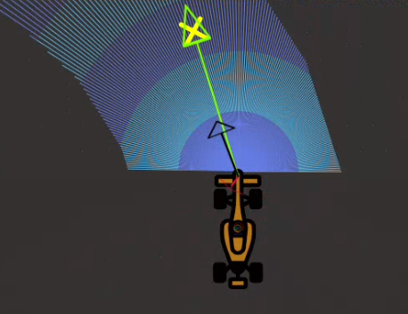

# P3 - Obstacle Avoidance
In this practice, I implemented an algorithm for a self-driving car to navigate towards waypoints while avoiding obstacles using the **Virtual Force Field (VFF) Algorithm**. The goal is to balance the attractive force pulling the robot towards its target with the repulsive forces pushing it away from nearby obstacles.

## Implementation
### Coordinate System Transformation
Since global coordinates are provided relative to the map origin, they must be transformed into the vehicle's local frame using the robot's pose.

### Forces Calculation
- **Attractive Force**: The robot calculates a vector pointing towards the target, with a magnitude scaled by the constant `ALPHA`. This force pulls the robot towards the goal.

- **Repulsive Force**: The robot computes repulsive forces from obstacles detected by the laser scanner. Each laser point creates a repulsive vector inversely proportional to the square of the distance to the obstacle, scaled by `BETA`.

- **Resultant Force**: The vector sum of both forces (attractive and repulsive) defines the instantaneous desired trajectory direction.

### Movement
The robot adjusts its velocity based on the direction of this resultant force:
- **Angular Velocity (W)**: Determines how much the robot should turn towards the resultant force direction.

- **Linear Velocity (V)**: Calculated based on the angular velocity, making the robot slow down as it turns sharply.

## Demonstration
<video width="600" controls>
  <source src="rob_mov/obstacle_avoidance.mp4" type="video/mp4">
  Your browser does not support the video tag.
</video>

<style>
  body {
    background-color: #121212; /* Fondo oscuro */
    color: #E0E0E0; /* Texto claro */
  }

  h1, h2, h3 {
    color: #BB86FC; /* Púrpura para encabezados */
  }

  a {
    color: #03DAC6; /* Verde azulado para enlaces */
  }

  video {
    border: 2px solid #BB86FC; /* Borde púrpura alrededor del video */
  }
