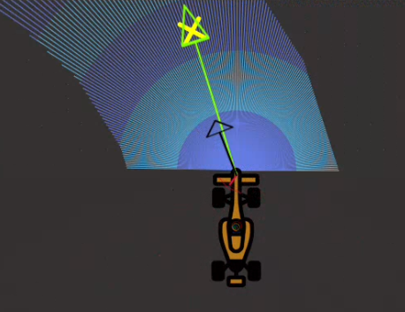

# P3 - Obstacle Avoidance
In this practice, I implemented an algorithm for a self-driving car to navigate towards waypoints while avoiding obstacles using the **Virtual Force Field (VFF) Algorithm**. The goal is to balance the attractive force pulling the robot towards its target with the repulsive forces pushing it away from nearby obstacles.

## Implementation
### Coordinate System Transformation
Since global coordinates are provided relative to the map origin, they must be transformed into the vehicle's local frame using the robot's pose.

### Forces Calculation
- **Attractive Force**: The robot calculates a vector pointing towards the target, with a magnitude scaled by the constant `ALPHA`. This force pulls the robot towards the goal.

- **Repulsive Force**: The robot computes repulsive forces from obstacles detected by the laser scanner. Each laser point creates a repulsive vector inversely proportional to the square of the distance to the obstacle, scaled by `BETA`.

- **Resultant Force**: The vector sum of both forces (attractive and repulsive) defines the instantaneous desired trajectory direction.

### Movement
The robot adjusts its velocity based on the direction of this resultant force:
- **Angular Velocity (W)**: Determines how much the robot should turn towards the resultant force direction.

- **Linear Velocity (V)**: Calculated based on the angular velocity, making the robot slow down as it turns sharply.

### Iterative Development and Progress

Implementing the Virtual Force Field (VFF) navigation algorithm required several adjustments to handle edge cases in the laser sensor readings, balance force magnitudes, and ensure smooth cornering around obstacles:

1. **Initial Prototype: Unfiltered Laser Readings and Unbalanced Forces**
   * **Initial design:** In the first version, I transformed the 180-degree laser scan into robot-relative Cartesian coordinates (`parse_laser_data`) and accumulated the repulsive vectors alongside a normalized attractive force toward the target waypoint (`absolute2relative`).
   * **Observed limitations:** Two issues immediately appeared during simulation tests. First, when the laser rays did not hit any obstacle within range, infinite distance readings (`inf`) produced `NaN` values during vector normalization, breaking the resultant force calculation. Second, without normalizing the cumulative sum of the 180 repulsive rays, the obstacle vector completely overwhelmed the attractive vector even when walls were far away.

2. **Repulsive Vector Stabilization and Gain Tuning (`ALPHA` & `BETA`)**
   * **Sensor filtering and inverse-square weighting:** I added a validity check (`np.isfinite(rep_magnit)`) to discard out-of-range laser readings and scaled each obstacle's contribution by an inverse-square law ($\frac{1}{d^2}$) averaged across the 180 beams (`len(laser_xy)`). This ensured that distant boundaries exerted negligible influence while nearby obstacles generated a strong, localized push.
   * **Force balancing:** Through iterative testing in the circuit, I tuned the attraction and repulsion weights to `ALPHA = 3.0` and `BETA = -2.0` (with negative sign to invert the obstacle-pointing vectors), achieving a stable resultant vector (`average_force`) capable of steering around obstacles without getting trapped in local minima.

3. **Kinematic Control and Waypoint Transition Tuning**
   * **Speed modulation for tight avoidance:** Using a constant linear velocity caused the car to drift wide or clip obstacles during sharp avoidance maneuvers. To fix this, I derived the angular velocity directly from the resultant force heading (`math.atan2`) and coupled the linear velocity inversely to the steering angle (`3.5 * (1 - abs(angular_vel) / math.pi)`), allowing the vehicle to decelerate smoothly in sharp turns and accelerate up to `3.5 m/s` on clear straightaways.
   * **Target acceptance radius:** Finally, I calibrated the waypoint switching threshold to `0.6 m` (`attr_magnit < 0.6`), preventing the robot from orbiting around targets placed close to track obstacles.

## Demonstration

<video width="600" controls>
  <source src="rob_mov/obstacle_avoidance_2.mp4" type="video/mp4">
  Your browser does not support the video tag.
</video>

<style>
  body {
    background-color: #121212; /* Fondo oscuro */
    color: #E0E0E0; /* Texto claro */
  }

  h1, h2, h3 {
    color: #BB86FC; /* Púrpura para encabezados */
  }

  a {
    color: #03DAC6; /* Verde azulado para enlaces */
  }

  video {
    border: 2px solid #BB86FC; /* Borde púrpura alrededor del video */
  }
