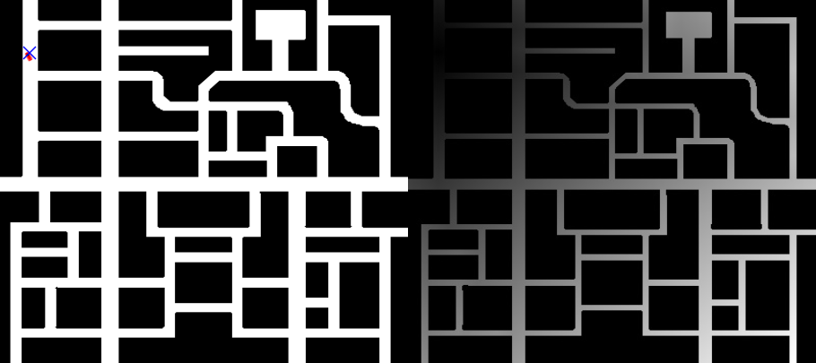
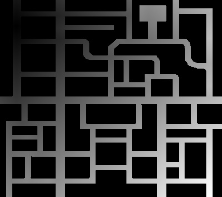
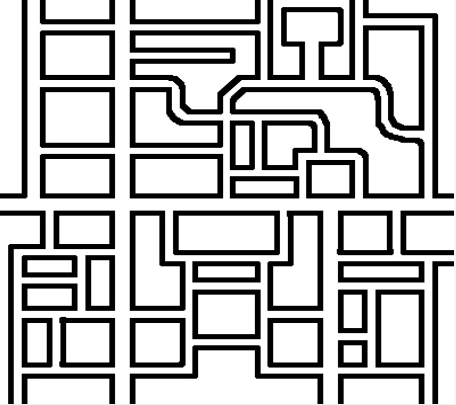

# P4 - Global Navigation using TeleTaxi
In this practice, I implemented an algorithm for a self-driving car to navigate towards a destination selected on the map while driving through the city using **Gradient Path Planning**. The **Wave Front Algorithm** builds a **cost map** and an **obstacle map**, which together define the gradient used for navigation.

## Implementation
### Cost map
The **cost map** represents the propagation of costs starting from the destination. The cost at each cell is calculated based on the distance from the destination. It is initialized with infinite values and updated iteratively to propagate costs across the grid.

### Obstacle map
The **obstacle map** accounts for obstacles and applies a safety margin (inflation) around them to create a buffer zone. Obstacles and penalized cells are marked with zero values to prevent the car from driving too close to walls.

### Navigation with Gradient Path Planning (GPP)
The navigation process includes three key steps:
1. **Cost Propagation**: The destination cell is assigned a cost of 0, and costs propagate outward across the grid using **Dijkstra's algorithm** (via a `PriorityQueue`), correctly weighting orthogonal (1.0) and diagonal (1.414) movements.
2. **Obstacle Penalty**: Obstacles are inflated to preserve a safe turning radius and prevent collisions in tight corridors.
3. **Gradient Navigation**: The car evaluates local lookahead cells to move toward the neighbor with the lowest cost value, dynamically calculating linear and angular velocity commands via a proportional controller.

### Iterative Development and Progress

1. **Initial Prototype: 4-Connected Wavefront and Immediate Neighbor Descent**
   * **Initial design:** In the first version, I implemented a basic Wavefront expansion starting from the target cell (`cost = 0.0`) using a `PriorityQueue` and 4-connected cardinal movements, paired with a greedy local controller that evaluated only the immediate adjacent cells (`radius = 1`) around the taxi's grid position.
   * **Observed limitations:** Two major issues appeared during navigation tests. First, restricting expansion to 4 directions produced unnatural trajectories. Second, evaluating only a 1-cell neighborhood caused severe **zigzagging** along straight avenues.

2. **Map Representation Upgrade: 8-Connected Costs and Obstacle Inflation**
   * **Euclidean-like propagation:** I expanded the Wavefront search to 8 directions (`DIRECTIONS`), assigning a step cost of `1.0` for cardinal moves and `1.414` ($\sqrt{2}$) for diagonals inside `expand_wavefront`. This produced much smoother, diagonal-aware cost gradients across open intersections.
   * **Safety margin (`apply_penalty`):** To keep the vehicle away from walls and sharp corners, I introduced a separate `obstacle_map` with an inflation radius of 3 cells (`penalty_radius = 3`) around every detected wall pixel (`city_map == 0`). By ignoring inflated cells (`obstacle_map == 0`) during local gradient selection, the taxi naturally maintained a safe clearance from sidewalks and buildings.

3. **Trajectory Smoothing and Event-Driven Replanning**
   * **Lookahead window (`lookahead_radius = 5`):** To eliminate discrete grid zigzagging, I expanded the local gradient search in `navigation()` from immediate neighbors to an 11x11 window (`lookahead_radius = 5`). Selecting the minimum-cost valid cell several steps ahead acted as a natural low-pass filter, yielding smooth steering commands (`kp_w = 1.8`) and stable speed modulation (`v_max = 4.0`, reduced proportionally to `angle_diff` in sharp turns).
   * **Execution optimization and goal stopping:** Finally, I decoupled map generation from the control loop so `expand_wavefront` and `display_map` run only once whenever a new destination is selected in the GUI (`current_target != dest_target`), and added a world-coordinate stopping threshold (`dist_to_goal < 1.5` m) to bring the taxi cleanly to a halt upon arrival.

## Demonstration
<video width="600" controls>
  <source src="rob_mov/video-P4.mp4" type="video/mp4">
  Your browser does not support the video tag.
</video>

<style>
  body {
    background-color: #121212; /* Fondo oscuro */
    color: #E0E0E0; /* Texto claro */
  }

  h1, h2, h3 {
    color: #BB86FC; /* Púrpura para encabezados */
  }

  a {
    color: #03DAC6; /* Verde azulado para enlaces */
  }

  video {
    border: 2px solid #BB86FC; /* Borde púrpura alrededor del video */
  }
