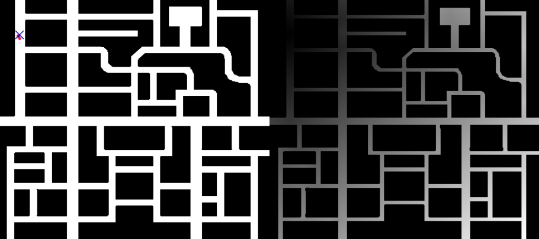
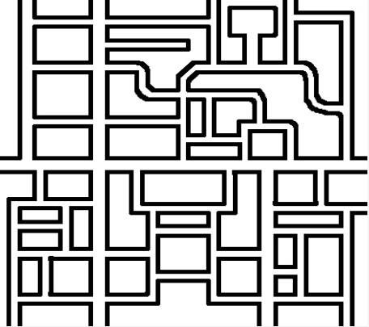

# P4 - Global Navigation using TeleTaxi
In this practice, I implemented an algorithm for a self-driving car to navigate towards a destination selected on the map while driving through the city using **Gradient Path Planning**. The **Wave Front Algorithm** builds a **cost map** and an **obstacle map**, which together define the gradient used for navigation.

## Implementation
### Cost map
The **cost map** represents the propagation of costs starting from the destination. The cost at each cell is calculated based on the distance from the destination. It is initialized with infinite values and updated iteratively to propagate costs across the grid.

### Obstacle map
The **obstacle map** accounts for obstacles and applies a safety margin (inflation) around them to create a buffer zone. Obstacles and penalized cells are marked with zero values to prevent the car from driving too close to walls.

### Navigation with Gradient Path Planning (GPP)
The navigation process includes three key steps:
1. **Cost Propagation**: The destination cell is assigned a cost of 0, and costs propagate outward across the grid using **Dijkstra's algorithm** (via a `PriorityQueue`), correctly weighting orthogonal (1.0) and diagonal (1.414) movements.
2. **Obstacle Penalty**: Obstacles are inflated to preserve a safe turning radius and prevent collisions in tight corridors.
3. **Gradient Navigation**: The car evaluates local lookahead cells to move toward the neighbor with the lowest cost value, dynamically calculating linear and angular velocity commands via a proportional controller.

## Demonstration
<video width="600" controls>
  <source src="rob_mov/video-P4.mp4" type="video/mp4">
  Your browser does not support the video tag.
</video>

<style>
  body {
    background-color: #121212; /* Fondo oscuro */
    color: #E0E0E0; /* Texto claro */
  }

  h1, h2, h3 {
    color: #BB86FC; /* Púrpura para encabezados */
  }

  a {
    color: #03DAC6; /* Verde azulado para enlaces */
  }

  video {
    border: 2px solid #BB86FC; /* Borde púrpura alrededor del video */
  }
